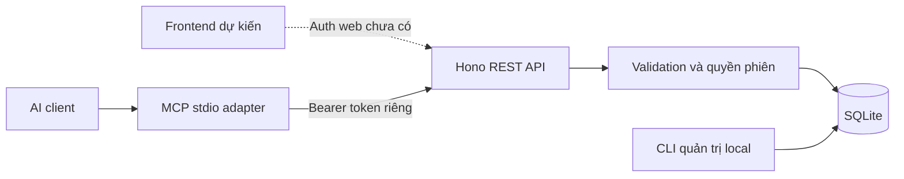
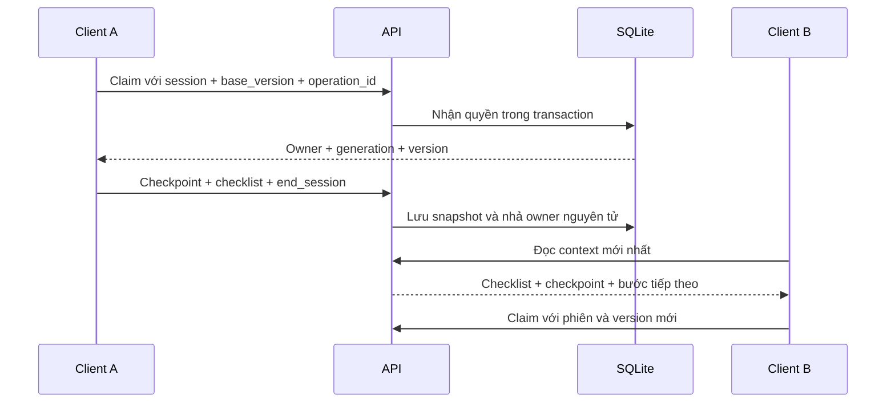
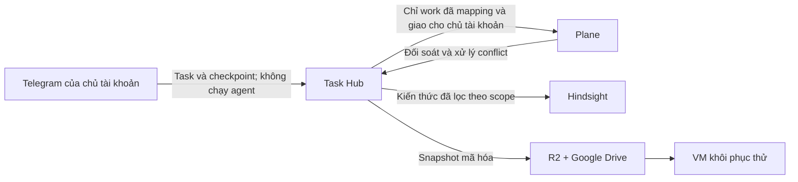

# Kiến trúc và tech stack

## Trạng thái

Đã có backend local, REST, MCP stdio và SQLite. Frontend, đăng nhập web, backup ngoài host và tích hợp chưa triển khai. Host production chưa chọn. Không công khai inventory máy, địa chỉ nội bộ hoặc credential trong tài liệu này.

| Thành phần | Quyết định | Hiện trạng |
|---|---|---|
| Frontend | React + Vite + Tailwind; Be Vietnam Pro + Lucide | Chưa triển khai; wireframe cần làm lại |
| Backend | TypeScript + Hono trên Node.js | MVP local |
| DB | SQLite; transaction ngắn; một writer | MVP local |
| Package manager | pnpm; frozen lockfile | Đã dùng |
| API contract | OpenAPI 3.1; sinh type FE; kiểm tra drift | Đã dùng |
| AI | MCP stdio adapter gọi REST cùng quyền | Test protocol qua HTTP đã qua; chưa cài client thực tế |
| Deploy | Docker Compose, volume bền vững | Chạy thử local; chưa deploy VM |

## Luồng hiện có

API hiện từ chối request có Origin. Cần thiết kế auth/origin trước khi browser gọi trực tiếp. Token AI không được cưỡng chế đóng owner; thao tác đó nằm trong CLI quản trị local có xác nhận.

## Quy tắc dữ liệu

- Task DB giữ trạng thái chuẩn; code nằm trong Git/PR, không sync working tree.
- Một owner mỗi task. Mất mạng không tự nhả quyền. Generation chặn phiên cũ; version chặn ghi đè bản mới.
- operation_id chống tạo mutation trùng khi retry. Retry cùng ID trả kết quả đã commit, cần đọc lại state trước bước mới.
- Checkpoint/private note là snapshot bất biến. Kết thúc phiên không tự Done; Done cần evidence theo project.
- Private note mặc định không xuất hiện trong response; cần quyền riêng và include_private=true.

Hợp đồng wire hiện tại: [openapi.yaml](../../openapi.yaml). Source validation: [contracts.ts](../../src/contracts.ts). DB: [migration 001](../../migrations/001.sql). Không dùng đặc tả cũ trong homelab/docs/task-hub để suy ra API hiện hành.

## Tích hợp dự kiến

Plane chỉ là tập con công việc. Task cá nhân, ghi chú riêng và full context không xuất sang Plane. Conflict giữ cả hai bản, không tự last-write-wins. Hindsight là bộ nhớ bổ sung, không thay DB trạng thái. Offline queue và idle checkpoint được làm sau, không bảo đảm hook đóng tab.

## Quyết định thiết kế

| Quyết định | Lý do / điều kiện xem lại |
|---|---|
| App riêng | Kiểm soát workflow bàn giao, phân tách personal/work và tích hợp |
| Node/Hono + SQLite | Stack đã chọn; chưa có benchmark chứng minh cần Go/Rust hoặc DB khác |
| Một backend | REST/MCP dùng cùng logic; chưa cần microservices/Redis |
| Owner explicit | Không cướp quyền khi client mất mạng; chủ tài khoản quyết định thu hồi |
| OpenAPI làm hợp đồng FE/BE | Thay spec và BE cùng nhau; gate chặn request/response lệch |
| Repo source riêng | task-hub giữ app; infra-selfhost giữ cấu hình triển khai; infra-vm-setup chuẩn bị VM |
| GitHub quản lý dự án | Issues là công việc; Milestones là phase; docs là thiết kế; commit/PR là bằng chứng |

Giới hạn đã biết: completion_evidence response đang là chuỗi JSON; chưa tự xác minh release. Backup/RPO ≤15 phút là mục tiêu chưa đạt. Deploy thật cần auth web, restore diễn tập và đo tài nguyên/latency.
