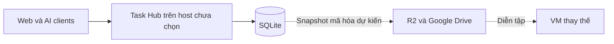

# Thiết kế các pha sau — chưa triển khai

Các yêu cầu dưới đây được chuyển từ tài liệu thiết kế gốc. Product/issues xác định phạm vi; chi tiết có chữ **đề xuất** cần đánh giá khi bắt đầu pha tương ứng.

## Runtime và host — #8

Một backend Node/Hono, một SQLite, Docker Compose. Web, MCP và runner là trách nhiệm logic, không mặc định là microservices. Chưa có lý do chọn Redis/broker/ORM hay nhiều DB adapter. UI dùng pattern UI kit cá nhân, Be Vietnam Pro và Lucide.

Đã cân nhắc Worker/D1 và managed PostgreSQL; bản đầu chọn VM + SQLite để restore runtime/DB sang VM khác. Máy chỉ bật khi cần không thể là trung tâm duy nhất. Host cụ thể chưa chọn; phải đo RAM/disk, tải và latency p50/p95/p99 trước khi quyết định. Giá/quota/ngân sách phải xác nhận lúc mua, không suy từ snapshot cũ.

Sơ đồ public giữ vai trò hệ thống; không chứa inventory, host riêng hoặc địa chỉ nội bộ.

## Plane — #9

- Chỉ project work đã mapping và task thuộc phạm vi giao cho chủ tài khoản. Personal không được tạo mapping; private note/full context/credential/lịch sử nội bộ không thuộc payload.
- Dựng outbound từ allowlist shared fields: trạng thái theo mapping, checklist/subtask, comment chia sẻ, link PR. Không serialize toàn task rồi xóa vài trường.
- Khi gỡ assignee: dừng outbound tự động, hỏi cách lưu trữ; không xóa bản local. Xóa dùng tombstone/archive, xác nhận trước lan truyền.
- Mutation và outbox phải cùng transaction. Inbox/outbox có ID ổn định, lưu kết quả, backoff và đối soát định kỳ; webhook không phải nguồn duy nhất. Origin/version mapping chống vòng lặp.
- Nếu API đích không có idempotency: tra external ID trước retry. Hai bên cùng sửa giữ cả hai bản, chủ chọn rồi tạo version mới; không last-write-wins.

Nhóm bảng dự kiến: integration_mappings, sync_outbox, sync_conflicts, tombstones và inbox dedup khi cần. Chưa có migration cho các bảng này. Issues GitHub phát triển Task Hub không phải task nghiệp vụ để sync sang Plane.

## Hindsight và Telegram — #10/#11

Task DB giữ tiến độ chuẩn; memory bổ sung kiến thức. Lọc nội dung/private data trước retain, chọn bank theo personal/work; lỗi memory không ngăn lưu checkpoint. Không gửi toàn transcript.

Telegram chỉ chủ tài khoản xem/tạo/sửa/chọn task và bàn giao qua API rules. Không khởi chạy agent. Chống lặp sự kiện và quyền owner/version vẫn áp dụng.

## Offline và AI adapters — #5/#12

MVP phải báo mất kết nối và giữ nháp trong phiên UI; chưa cần queue offline đầy đủ. Không hiện “đã lưu” trước server commit. Timeout sau ghi là kết quả chưa rõ: retry cùng payload/operation_id.

Đề xuất IndexedDB cho web draft/operation queue bền vững; CLI cần queue riêng nếu triển khai. Owner đã cấp có thể tiếp tục viết nháp offline; chưa có quyền thì không được tự claim. Reconnect kiểm tra generation/version, giữ nháp cùng bản server nếu conflict; không tự cập nhật generation để ép ghi.

Idle checkpoint mặc định đề xuất 15 phút, có cấu hình. Hook đóng tab/app chỉ là bổ sung sau khi kiểm chứng từng client; explicit handoff luôn cần. Claude Code/Codex phải thử thực tế hai môi trường (#5); Hermes/web AI adapters còn là pha sau, không hứa hỗ trợ hook chưa chứng minh.

## Backup và restore — #7

- Snapshot SQLite nhất quán bằng cơ chế DB/driver; không copy riêng DB đang ghi. Bao gồm checkpoint/private notes, owner, operations, và mapping/outbox/conflicts/tombstones khi các bảng đó tồn tại.
- Mã hóa trước upload R2 và Drive; key và hướng dẫn lấy credential độc lập với bản backup. Không đưa key vào Git/log/diagram.
- RPO mục tiêu ≤15 phút tính từ commit trung tâm tới bản ngoài host. Theo dõi tuổi backup từng đích; hai đích/timer xanh không chứng minh đạt RPO.
- Chu kỳ 5 phút, cảnh báo sau 10 phút và retention 30 ngày là **đề xuất chưa chốt**. Retention backup không tự xóa lịch sử checkpoint trong app.
- Restore runtime+DB trên VM thử, tắt outbound. Kiểm tra schema/counts/checksum/checkpoint mới nhất/tuổi backup; không phát lại comment/outbox đã gửi.

Đề xuất deployment epoch mới hoặc cơ chế tương đương để vô hiệu hóa session/claim/token cũ trước mở ghi sau restore; chưa có epoch trong migration hiện tại. Đọc/ghi thử và đối soát rồi mới xin duyệt cutover. Draft chưa gửi từ client không thuộc RPO trung tâm.

## Checklist nghiệm thu bảo toàn

Hai claim đồng thời chỉ một thắng; phiên bị thu hồi không ghi được; checkpoint+end nguyên tử; retry không trùng; conflict không mất hai bản; personal/private không xuất outbound; client khác đọc checkpoint mới nhất; Done cần hành động explicit và evidence theo project; restore dữ liệu/runtime từ bản mã hóa ngoài host. Gate nào chưa đạt thì không dùng dữ liệu thật cho phần phụ thuộc.
