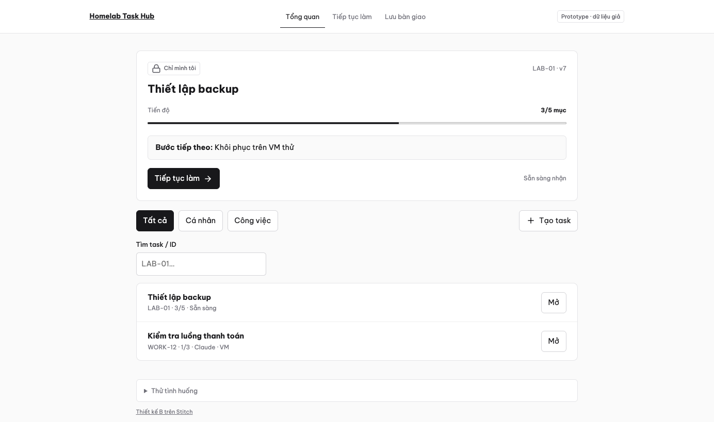
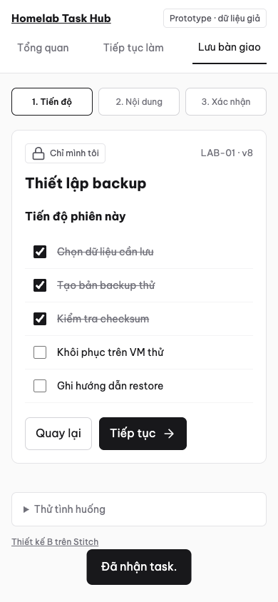

# Thiết kế giao diện

**Trạng thái: cần thiết kế lại.** Prototype B đã bấm thử được nhưng người dùng phản hồi khó hiểu cách sử dụng. Không coi giao diện hiện tại là đã duyệt hoặc frontend đã hoàn thành.

## Tài sản thiết kế

- [Prototype B](prototype-b.html): HTML có tương tác, dữ liệu giả trong bộ nhớ, reload sẽ reset. Tải file về và mở bằng browser; GitHub chỉ hiển thị source HTML.
- [Stitch project](https://stitch.withgoogle.com/projects/14967084553524389024): bản thiết kế tham khảo, có thể cần quyền truy cập. Repo lưu prototype và ảnh để không phụ thuộc link này.
- [Ảnh desktop](desktop.png) và [ảnh mobile](mobile.png): ảnh chụp demo cũ, không phải ứng dụng nối backend.

Mobile prototype B

## Yêu cầu đã chốt

Ít chữ; Be Vietnam Pro + Lucide; giữ pattern UI của các app cá nhân. Luồng cần rõ: chọn task → xem việc đã làm và bước tiếp theo → làm việc → lưu bàn giao. Người dùng phải phân biệt được bản nháp, dữ liệu đã lưu và phiên đang giữ task.

## Lần thiết kế tiếp theo

- [ ] Cho người dùng hiểu hành động chính trên mỗi màn mà không cần giải thích.
- [ ] Làm rõ task, phiên và bàn giao bằng ngôn ngữ quen thuộc.
- [ ] Hiện lỗi quyền phiên/mất mạng và giữ draft.
- [ ] Review desktop/mobile với người dùng trước khi nối frontend.

Tiến độ chính thức nằm ở Issues/Milestones; checklist ở đây là yêu cầu thiết kế, không phải bảng trạng thái thứ hai.
