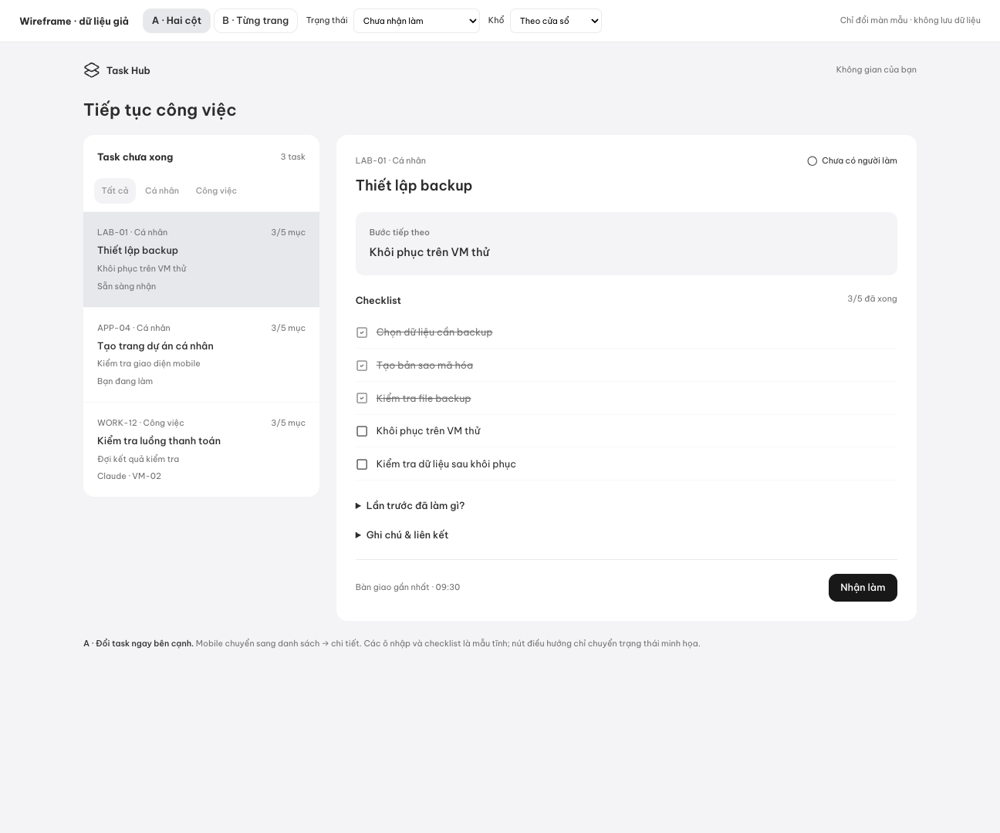

# Thiết kế giao diện

**Đã chọn bố cục A — hai cột.** Người dùng xác nhận “A 2 cột á”. Desktop đặt danh sách bên trái và chi tiết bên phải; mobile dùng danh sách → chi tiết. Đây là wireframe đã chọn, chưa phải frontend nối API.

## Bản được chọn

- [Wireframe A](layout-a/index.html): mở bằng browser, mặc định phương án A. Thanh trên cùng là công cụ review, không thuộc app; B chỉ giữ để đối chiếu.
- [Desktop](layout-a/a-desktop.png) · [Mobile](layout-a/ready-mobile.png) · [Bàn giao](layout-a/handoff-mobile.png)
- [Mất kết nối](layout-a/offline-mobile.png) · [Conflict](layout-a/conflict-mobile.png)

Luồng chính: chọn task → xem bước tiếp theo/checklist → Nhận làm → Lưu bàn giao. Hai hành động lưu tách biệt: **Lưu, tiếp tục làm** và **Lưu & kết thúc phiên**. Kết thúc phiên không tự đánh dấu task hoàn thành.

Đã kiểm tra browser ở viewport CSS 1440px và 375px, không tràn ngang; nút điều hướng đi đúng ba trạng thái nhận làm, bàn giao, kết thúc. Font Be Vietnam Pro, icon Lucide, giao diện sáng. Dữ liệu hoàn toàn giả. Checklist, bộ lọc, tạo task và ô nhập là mẫu tĩnh; không có lưu draft bền vững, auth hoặc kết nối API. Các nhãn giữ draft/mất mạng là yêu cầu cho frontend tương lai.

Chọn bố cục chưa thay thế bài kiểm tra người dùng tự thực hiện luồng chính. #3 giữ mở cho tới khi có xác nhận bước đó.

## Bản cũ để tham khảo

- [Prototype B](prototype-b.html): HTML có tương tác, dữ liệu giả trong bộ nhớ, reload sẽ reset. Tải file về và mở bằng browser; GitHub chỉ hiển thị source HTML.
- [Stitch project](https://stitch.withgoogle.com/projects/14967084553524389024): bản thiết kế tham khảo, có thể cần quyền truy cập. Repo lưu prototype và ảnh để không phụ thuộc link này.
- [Ảnh desktop](desktop.png) và [ảnh mobile](mobile.png): ảnh chụp demo cũ, không phải ứng dụng nối backend.

Mobile prototype B

## Yêu cầu đã chốt

Ít chữ; Be Vietnam Pro + Lucide; giữ pattern UI của các app cá nhân. Luồng cần rõ: chọn task → xem việc đã làm và bước tiếp theo → làm việc → lưu bàn giao. Người dùng phải phân biệt được bản nháp, dữ liệu đã lưu và phiên đang giữ task.

## Điều kiện trước triển khai frontend

- [ ] Cho người dùng hiểu hành động chính trên mỗi màn mà không cần giải thích.
- [ ] Làm rõ task, phiên và bàn giao bằng ngôn ngữ quen thuộc.
- [ ] Hiện lỗi quyền phiên/mất mạng và giữ draft.
- [x] Người dùng chọn bố cục A sau khi nhận hai phương án desktop/mobile.
- [ ] Xác nhận người dùng tự thực hiện luồng chính mà không cần giải thích.

Tiến độ chính thức nằm ở Issues/Milestones; checklist ở đây là yêu cầu thiết kế, không phải bảng trạng thái thứ hai.
